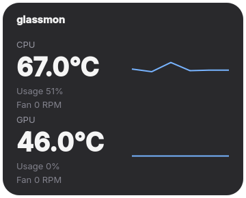

# glassmon

Minimal translucent hardware monitor widget for Linux. Shows CPU/GPU temperature, usage, and fan speed with a real-time temperature graph. Always on top, draggable frameless window.



## Build

Requires CMake 3.16+, Qt 6, and a C++20 compiler.

```bash
./build.sh
```

## Run

```bash
./build/glassmon
```

Right-click the widget to toggle always-on-top or exit. To install and enable autostart, run `./install.sh`.

## License

AGPL-3.0
